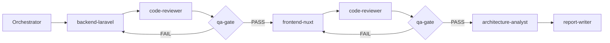

# Project context

Full-stack technical challenge (Laravel 11 + Nuxt 3) for a Senior Full-Stack Engineer role.
Read before any task:

- `docs/GOALS.md` — objective, measurable goals (G1–G7) and non-goals
- `docs/prd/` — one PRD per epic; start with `PRD-00-overview.md`
- `docs/frd/` — functional requirements split by domain; `FRD-00-overview.md` holds the default decisions
- `docs/EXECUTION_GUIDE.md` — phases, timeboxes and kickoff prompts

## Rules

- Follow the **default decisions** in `docs/frd/FRD-00-overview.md`; never invent or expand scope.
- Every relevant raw AI output goes into `docs/AI_LOG.md` **before** being refactored,
  with the verbatim prompt (see the `ai-evidence-log` skill). This log is the only
  legitimate source for Task 3 of `TASK_REPORT.md`.
- Never close a phase with failing tests or a failing `qa-gate` verdict:
  - backend: `cd backend && php artisan test`
  - frontend: `cd frontend && npx vitest run`
- Thin controllers, testable services, database-level aggregation (no N+1), zero `any` in TypeScript.

## Architectural Decision Protocol (mandatory — never skip)

A decision is **architectural** when it is NOT already frozen in
`docs/frd/FRD-00-overview.md` or in an FR row. Examples: adding or swapping a
dependency/package, database schema beyond the spec, auth strategy, state-management
or data-fetching approach, caching, deviations from the API contract, folder-structure
changes, test-strategy changes, and any technology choice in Task 4 that differs from
FR-R3/FR-R4.

When one appears: **STOP. Do not implement.** Ask the human using exactly this format:

```markdown
### Decision needed: <one-line problem>

Context: <2–3 lines — where it appeared and why it matters>

| Option | Approach | Pros | Cons |
| --- | --- | --- | --- |
| A | ... | ... | ... |
| B | ... | ... | ... |
| C | ... | ... | ... |

My recommendation: <letter>, because <one line>.
Reply with **A**, **B**, **C** — or describe your own approach and I'll implement that.
```

The three options must be genuinely different approaches, not variations of one.
Work stays paused until the human answers; the human's own solution always wins over
the presented options. After the answer, record the outcome in `docs/AI_LOG.md` under
`## Decision — <topic> — <date>` (options presented, choice, rationale) and only then
implement. Subagents never decide either: they surface the question to the
orchestrator, which asks the human. These decision records double as an ADR trail —
Task 3 evidence of engineering judgment.

## Agent pipeline

The main session is the **orchestrator**: it delegates, it does not implement.
Each implementation phase only closes after passing two independent gates.



| Agent | Role | Writes to |
| --- | --- | --- |
| `backend-laravel` | Implements FR-B1–B9 | `backend/`, AI_LOG |
| `frontend-nuxt` | Implements FR-F1–F9 | `frontend/`, AI_LOG |
| `code-reviewer` | Qualitative gate — hunts AI-typical defects | AI_LOG (findings) |
| `qa-gate` | Deterministic gate — runs suites, verifies every FR row PASS/FAIL | AI_LOG (verdicts) |
| `architecture-analyst` | Task 4 RCA + 50x proposal + Mermaid | `docs/task4-architecture.md` |
| `report-writer` | Compiles TASK_REPORT.md from logged evidence only | `TASK_REPORT.md` |

Skills (`.claude/skills/`): `jsonapi-laravel` (API contract), `optimistic-ui-vue`
(FR-F5 pattern), `ai-evidence-log` (mandatory logging protocol) — they auto-trigger;
agents must follow them.

## Workflow

P0 scaffold → P1 `backend-laravel` → gates → P2 `frontend-nuxt` → gates →
P3 `architecture-analyst` → P4 `report-writer`. Timeboxes in `docs/EXECUTION_GUIDE.md`.
