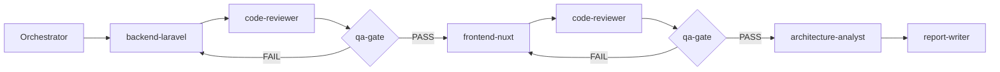
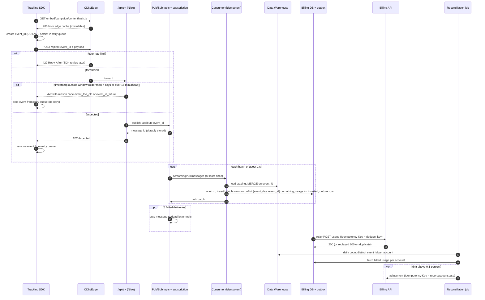

# TASK_REPORT — B2B Full-Stack Task Submission

Laravel 11 API + Nuxt 3 applicant review card, plus an AI-workflow showcase and an architecture triage.
Every prompt, snippet, finding, verdict and decision below is quoted from `docs/AI_LOG.md`, `docs/task4-architecture.md` or the code in this repository. Where the log has no data, the report says so.

| Section | Covers |
| --- | --- |
| [1. Tasks 1 & 2 — Implementation](#1-tasks-1--2--implementation-summary) | FR-B1–B9, FR-F1–F9 |
| [2. Task 3 — AI Tooling & Engineering Showcase](#2-task-3--ai-tooling--engineering-showcase) | FR-R1 |
| [3. Task 4 — Architecture & Triage](#3-task-4--architecture--triage) | FR-R2–FR-R5 |
| [4. Known limitations](#4-known-limitations) | — |
| [5. Repository structure check](#5-repository-structure-check) | G5 |

---

## 1. Tasks 1 & 2 — Implementation summary

### 1.1 Task 1 — Applicant Summary API (Laravel 11, `backend/`)

`GET /api/v1/campaigns/{campaignId}/applicant-summary` returns a JSON:API document: paginated `data[]` of applicants, `meta.summary` (total, eligible ≥ 70, average AI score, top-tier ≥ 90 capped at 5), `meta.pagination` and `links`. Mock auth via a non-empty `X-Partner-Token`. Errors are always JSON:API `errors[]` with `application/vnd.api+json`.

| Concern | File |
| --- | --- |
| Route (hand-made, registered via `withRouting(api:)`) | `backend/routes/api.php`, `backend/bootstrap/app.php` |
| Mock auth (401) | `backend/app/Http/Middleware/EnsurePartnerToken.php` |
| Validation (422) + campaign lookup (404) | `backend/app/Http/Requests/ApplicantSummaryRequest.php` |
| Thin invokable controller (envelope + links) | `backend/app/Http/Controllers/ApplicantSummaryController.php` |
| Aggregation + filtered list | `backend/app/Services/ApplicantSummaryService.php` |
| Resource shape | `backend/app/Http/Resources/ApplicantResource.php` |
| Client-safe error marker | `backend/app/Exceptions/ApiException.php` |
| JSON:API error rendering | `backend/bootstrap/app.php` (`withExceptions`) |
| Schema | `backend/database/migrations/2026_10_14_230822_create_applicants_table.php`, `backend/app/Enums/ApplicantStatus.php` |
| Tests | `backend/tests/Feature/ApplicantSummaryTest.php` (26), `backend/tests/Unit/ApplicantSummaryServiceTest.php` (4) |

**Architectural choices**

- **Layering.** Controller → FormRequest → `ApplicantSummaryService` → Eloquent query builder. The controller only assembles the envelope and links; validation and the 404 live in the FormRequest; all metric logic is in the service, which is unit-testable without HTTP.
- **Database-level aggregation (no N+1).** `summary()` is one aggregate query (`COUNT`, conditional `SUM(CASE …)`, `AVG`) plus one `LIMIT 5` query. NULL `SUM`/`AVG` on an empty campaign are coalesced, and `JSON_PRESERVE_ZERO_FRACTION` keeps `0.0`. A unit test pins the query count at 2 for 100 applicants. The composite index `(campaign_id, ai_score)` serves both filter and `ORDER BY` (qa-gate: `EXPLAIN QUERY PLAN` → `SEARCH applicants USING INDEX applicants_campaign_id_ai_score_index`).
- **Integrity in the database, not only in PHP.** `status` is a string-backed PHP enum cast on the model *and* a DB enum/CHECK whose values are derived from the PHP enum; `ai_score` has a `CHECK (ai_score BETWEEN 0 AND 100)` added via `Blueprint::rawColumn` (Laravel 11 has no `check()` modifier).
- **Contract semantics.** `min_score` narrows `data[]` and `meta.pagination` only; `meta.summary` stays campaign-wide. List order is `ai_score DESC, id ASC` for deterministic pagination. Both were human decisions (see 2.3).
- **Error hygiene.** Only messages raised through `ApiException` (our 401 and campaign 404) reach `detail`; framework messages get the status title, and exception headers such as `Allow` on 405 are kept. Pagination links are built from `APP_URL`, never from the request `Host`.

### 1.2 Task 2 — Applicant Review & Match Card (Nuxt 3, `frontend/`)

A single `ApplicantReviewCard` showing campaign metrics, a debounced min-score slider, applicant cards with a colour + text tier badge, formatted date and up to 4 highlight bullets, and optimistic Shortlist/Reject with disabled buttons, `aria-busy` and rollback message. Skeleton while loading; two distinct empty states (no match vs. no applicants).

| Concern | File |
| --- | --- |
| Contract types (mirror of FR-B7) | `frontend/types/applicant.ts` |
| Data composable (`data`, `pending`, `error`, `refresh`; 300 ms debounce; stale-response guard) | `frontend/composables/useApplicantSummary.ts` |
| Component | `frontend/components/ApplicantReviewCard.vue`, wired in `frontend/app.vue` |
| Mock fixture + pure JSON:API builder | `frontend/server/mock/applicant-summary.ts` |
| Summary GET route (proxy or mock) | `frontend/server/api/v1/campaigns/[campaignId]/applicant-summary.get.ts`, `frontend/server/utils/backend-proxy.ts` |
| Status PATCH route (mock-only) | `frontend/server/api/v1/applicants/[id]/status.patch.ts`, `frontend/server/utils/status-update.ts` |
| JSON:API helpers | `frontend/server/utils/json-api.ts` |
| Tests | `frontend/tests/ApplicantReviewCard.test.ts` (9), `frontend/tests/backend-proxy.test.ts` (3), `frontend/tests/status-update.test.ts` (3) |

**Architectural choices**

- **Contract first, zero `any`.** `types/applicant.ts` was written first from the real Laravel resource/controller; unknown input is narrowed with type guards. qa-gate: `vue-tsc --noEmit` 0 errors, 0 typing escapes.
- **Composable owns fetching, component owns UI.** The composable debounces the slider (300 ms) and discards out-of-order responses with a request counter; the component holds only UI state (`busy`, `actionErrors`) and the optimistic update, which settles onto the *current* row for an id so a concurrent refetch cannot orphan it.
- **Server-side data source.** The browser only talks to Nuxt server routes. With `NUXT_BACKEND_URL` set, the summary GET is proxied to Laravel and `X-Partner-Token` is added server-side (never under `runtimeConfig.public`); unset, a fixture builder that mirrors the backend contract answers. The PATCH status endpoint never reaches Laravel because no FR defines a write endpoint.
- **Testable without the Nuxt runtime.** Plain Vitest + `@vue/test-utils` + `happy-dom`; proxy and status logic are pure functions with injected `fetch`/store, so all branches are unit-tested.
- **Tooling.** Tailwind v4 via `@tailwindcss/vite` and one CSS file; no Nuxt module, no config file.

### 1.3 How to run

Full setup is in [`README.md`](README.md) (backend: `composer install`, `.env`, `key:generate`, `migrate --seed`, `serve`; frontend: `npm install`, `npm run dev`; optional real-backend proxy via `NUXT_BACKEND_URL`).

| Suite | Command | Result |
| --- | --- | --- |
| Backend | `cd backend && php artisan test` | **30 passed (229 assertions)**, 0 warnings/deprecations |
| Frontend | `cd frontend && npx vitest run` | **15 passed (15)** in 3 files |

`vendor/bin/phpunit` runs clean; the warnings under `php artisan test` without an env file are a Collision printer bug (reported suppressed warnings), worked around with a comment-only `.env.testing`.

Source: `## QA gate — final check fix — 2026-10-15` in `docs/AI_LOG.md`, the last gate entry that ran both suites (backend also without a `.env` file). `vue-tsc --noEmit` exit 0 and `npm run build` complete are from `## QA gate (re-run) — P2 frontend — 2026-10-14`; no frontend code changed after it. P3 and P4 changed no application code. The orchestrator re-ran both suites while this report was finalised (2026-10-15), with the same counts: backend 30 passed (229 assertions), frontend 15 passed (15).

---

## 2. Task 3 — AI Tooling & Engineering Showcase

### 2.1 The workflow: implementer → reviewer → gate

The main Claude Code session acts as **orchestrator** and does not write code. Each implementation phase runs through three independent agents defined in `.claude/agents/`:



Each **implementer** (`backend-laravel` / `frontend-nuxt`) works in blocks and logs the verbatim prompt and **raw** output to `docs/AI_LOG.md` before any refactor. An adversarial **`code-reviewer`** then hunts AI-typical defects with severity and `file:line`, and a deterministic **`qa-gate`** marks every FR row, human decision and finding PASS/FAIL with evidence, looping FAILs back to the implementer. Anything not frozen in the FRD stops work and goes to the human as three options (the Architectural Decision Protocol). In practice: P0 one follow-up, P1 one review loop-back, P2 one review loop-back plus one qa-gate FAIL loop-back, P3 two drafts plus a human edit pass. The rationale behind the kit is in [`docs/WORKFLOW.md`](docs/WORKFLOW.md).

### 2.2 Exact AI prompts used

Quoted unchanged from `docs/AI_LOG.md`.

**Prompt 1 — P1 review loop-back (orchestrator → `backend-laravel`), logged "Prompt (verbatim)", entry `2026-10-14 20:26 — P1 backend — review fixes`:**

```text
P1 review loop-back for /Users/fernandoviviurka/Desktop/Projetos/b2b-fullstack-task-submission/backend. Read `## Review findings — P1 backend — 2026-10-14` in docs/AI_LOG.md and fix exactly these findings:
- #1: add a max on `page.number` in ApplicantSummaryRequest (e.g. `max:1000000`) and a matching row in the invalid-query provider.
- #2: pagination links must not come from an untrusted Host header. Use Laravel's built-in `$middleware->trustHosts()` in bootstrap/app.php (a framework feature, not a new package). Add a test that `Host: evil.example` does not end up in `links`. Note that `trustHosts` may be a no-op when running locally or under tests; check this in vendor. If it doesn't protect in tests, build the links from `config('app.url')` instead.
- #3: the min_score/summary test must assert the whole `meta.summary` block.
- #4: add a provider of valid boundary values (min_score 0 and 100, page[size] 1 and 100) that expects 200.
- #6: for HTTP errors below 500, keep our own `abort()` messages (401/404 campaign) but replace framework messages (route not found and similar) with a generic detail. No route paths in `detail`.
- #7: merge `$e->getHeaders()` into the error response (the 405 `Allow` header).
- #9: switch from `@dataProvider` doc-comments to `#[DataProvider]` attributes.
Skip #8 and #10. Don't change #5 (the min_score scope and the list order); it's pending with the human.

Log per the ai-evidence-log skill: one AI_LOG entry `P1 backend — review fixes` with this prompt and the diff of each change. Run `php artisan test` until it's green with no deprecations. Don't run code-reviewer or qa-gate. Report: the changes per finding and the final test output.
```

**Prompt 2 — P2 qa-gate loop-back (orchestrator → `frontend-nuxt`), logged "Prompt (verbatim)", entry `2026-10-14 22:58 — P2 frontend — qa-gate fix: proxy-mode PATCH`:**

```text
P2 qa-gate loop-back in /Users/fernandoviviurka/Desktop/Projetos/b2b-fullstack-task-submission. First read `## QA gate — P2 frontend — 2026-10-14` and `## Decision — Shortlist/Reject in proxy mode — 2026-10-14` in docs/AI_LOG.md.

Implement Decision A:
- In `frontend/server/api/v1/applicants/[id]/status.patch.ts`, when the server-only runtime config `backendUrl` is set, accept any well-formed id (`^[1-9]\d*$`, otherwise a 422 in `errors[]` form), validate `status` as today, and keep the new status in an in-memory map by id. Return 200 with the same response shape as now, and skip the fixture lookup.
- When `backendUrl` is unset, behaviour stays exactly as it is now.
- Keep the logic testable without the Nuxt runtime, like backend-proxy.ts, using a small pure function if needed.
- Add a test: proxy mode with id 25 gives 200 and the status is stored; a malformed id gives 422; and the existing mock-mode behaviour is unchanged.
- Correct `README.md` (around lines 50-52). In proxy mode, Shortlist/Reject work for any applicant, but the status lives only in the Nuxt server's memory: it is never saved to Laravel and is lost on restart. That's because no FR defines a backend write endpoint.

Log per the ai-evidence-log skill: one AI_LOG entry `P2 frontend — qa-gate fix: proxy-mode PATCH` with this prompt and the raw diff. Zero `any`. Done means `npx vitest run`, `npx vue-tsc --noEmit` and `npm run build` all pass. Then verify end to end:
- Laravel on a spare port against a seeded scratch DB (don't touch backend/database/database.sqlite), plus the built Nuxt server with NUXT_BACKEND_URL;
- `PATCH /api/v1/applicants/12/status` and `PATCH /api/v1/applicants/25/status` with `{"status":"shortlisted"}` both return 200;
- stop both servers.
Don't run code-reviewer or qa-gate. Report the changes and all outputs.
```

**Prompt 3 — P1 metrics block. The log marks this one "verbatim excerpt"; it is an excerpt, not the full prompt (entry `2026-10-14 20:20 — P1 backend — metrics`):**

```text
- Aggregates (FR-B4) must be computed in the database (one aggregate query), never in a PHP loop. Guard against an empty campaign.
```

What these show: prompts name the FR ids and findings they act on, set explicit scope ("fix exactly these", "Skip #8 and #10"), include a fallback when the first approach may not work (Prompt 1, `trustHosts` → `config('app.url')`; the agent confirmed the fallback was needed), and define "done" as runnable checks.

### 2.3 Raw vs. refactored

**Pair 1 — pagination links (backend).** Raw from the AI_LOG entry `2026-10-14 20:20 — P1 backend — endpoint …`; final from `backend/app/Http/Controllers/ApplicantSummaryController.php:34-47`.

<table>
<tr><th>Raw AI output (AI_LOG)</th><th>Final code (repo)</th></tr>
<tr><td>

```php
private function links(ApplicantSummaryRequest $request, LengthAwarePaginator $page): array
{
    $url = fn (int $number) => $request->fullUrlWithQuery(['page' => ['number' => $number, 'size' => $page->perPage()]]);

    return [
        'first' => $url(1),
        'last' => $url($page->lastPage()),
        'prev' => $page->currentPage() > 1 ? $url($page->currentPage() - 1) : null,
        'next' => $page->hasMorePages() ? $url($page->currentPage() + 1) : null,
    ];
}
```

</td><td>

```php
private function links(ApplicantSummaryRequest $request, LengthAwarePaginator $page): array
{
    // Built from APP_URL, never from the client-controlled Host header (TrustHosts is off under local/testing).
    $base = rtrim(config('app.url'), '/').'/'.$request->path();
    $url = fn (int $number) => $base.'?'.Arr::query([...$request->query(), 'page' => ['number' => $number, 'size' => $page->perPage()]]);

    return [
        'first' => $url(1),
        'last' => $url($page->lastPage()),
        // Past the end, prev points back to the last real page rather than another empty one.
        'prev' => $page->currentPage() > 1 ? $url(min($page->currentPage() - 1, $page->lastPage())) : null,
        'next' => $page->hasMorePages() ? $url($page->currentPage() + 1) : null,
    ];
}
```

</td></tr>
</table>

Two defects fixed, both caught outside the generating agent's own tests:
- **Host-header injection.** `fullUrlWithQuery()` builds absolute URLs from the client-controlled `Host`; `Host: evil.example` produced `links.first = http://evil.example/...` (code-reviewer P1 #2). The agent checked vendor `TrustHosts::shouldSpecifyTrustedHosts()` and found it returns false under `local` and unit tests, so `trustHosts()` would not protect; links now come from `APP_URL`. Test `test_links_ignore_a_spoofed_host_header` fails against the original controller.
- **Out-of-range `prev` link.** With `page[number]` past the end (99 of 4), `prev` pointed at page 98, also empty. Found in a manual smoke test; now clamped with `min(..., lastPage())` and asserted in `test_paginates_with_links`.

**Pair 2 — optimistic status update (frontend).** Raw from `2026-10-14 20:43 — P2 frontend — ApplicantReviewCard.vue …`; final from `frontend/components/ApplicantReviewCard.vue:40-60`.

<table>
<tr><th>Raw AI output (AI_LOG)</th><th>Final code (repo)</th></tr>
<tr><td>

```ts
async function setStatus(applicant: ApplicantResource, next: ApplicantStatus): Promise<void> {
  const previous = applicant.attributes.status
  applicant.attributes.status = next
  busy.value[applicant.id] = true
  delete actionErrors.value[applicant.id]
  try {
    await $fetch(`/api/v1/applicants/${applicant.id}/status`, { method: 'PATCH', body: { status: next } })
  } catch {
    applicant.attributes.status = previous
    actionErrors.value[applicant.id] = `Could not update ${applicant.attributes.name}'s status. Please try again.`
  } finally {
    delete busy.value[applicant.id]
  }
}
```

</td><td>

```ts
// A refetch may replace `data` while the PATCH is in flight, so settle onto the current row for that id.
function setCurrentStatus(id: string, status: ApplicantStatus): void {
  const current = data.value?.data.find(a => a.id === id)
  if (current) current.attributes.status = status
}

async function setStatus(applicant: ApplicantResource, next: ApplicantStatus): Promise<void> {
  const { id, attributes: { name, status: previous } } = applicant
  applicant.attributes.status = next
  busy.value[id] = true
  delete actionErrors.value[id]
  try {
    await $fetch(`/api/v1/applicants/${id}/status`, { method: 'PATCH', body: { status: next } })
    setCurrentStatus(id, next)
  } catch {
    setCurrentStatus(id, previous)
    actionErrors.value[id] = `Could not update ${name}'s status. Please try again.`
  } finally {
    delete busy.value[id]
  }
}
```

</td></tr>
</table>

Defect: **stale object reference / race between PATCH and refetch** (code-reviewer P2 #2). The raw version wrote the result to the captured object. If a slider refetch replaced `data` while the PATCH was in flight, the success was written to an orphaned object and the UI showed "Pending review" with no error. Fix: settle onto the current row by id. Test "keeps the new status when a refetch lands while the PATCH is in flight" was mutation-checked (fails with the old write: 1 failed / 8 passed).

### 2.4 Critical engineering judgment — defects found and how they were fixed

**Backend (P1).** Source: `## Review findings — P1 backend`, `## 2026-10-14 20:21 — P1 backend — tests` refactor notes, `## QA gate — P1 backend`.

| Defect (technical name) | Found by | Evidence | Fix | Verified |
| --- | --- | --- | --- | --- |
| **Integer overflow in pagination offset** — no upper bound on `page[number]`; `999999999999999999` overflowed `(page-1)*size` and returned page-1 rows while `meta.pagination.page` echoed the huge number (data contradicts meta) | code-reviewer #1 | `ApplicantSummaryRequest.php:28` | `page.number` → `between:1,1000000`; invalid row `1000001` (422) and valid row `1000000` (200) | qa-gate FIXED; live → 422 |
| **Host-header injection** into absolute pagination URLs | code-reviewer #2 | `Host: evil.example` → `links.first = http://evil.example/...` | Links from `config('app.url')` (see 2.3) | qa-gate FIXED; test + live |
| **Weak assertion** — the contested "min_score doesn't touch summary" test checked only `total_applicants` | code-reviewer #3 | `ApplicantSummaryTest.php:130-139` | `assertSame` on the whole `meta.summary` block | qa-gate FIXED |
| **Missing acceptance-side boundary tests** — nothing proved `min_score=0/100`, `page[size]=1/100` are accepted | code-reviewer #4 | `ApplicantSummaryTest.php:117-128` | `validBoundaryQueries` provider → 200 | qa-gate FIXED |
| **Information leak in error `detail`** — framework messages exposed route paths | code-reviewer #6 | `"The route api/v1/nope could not be found."` | `ApiException` marker; only our messages pass through | qa-gate FIXED |
| **Missing `Allow` header on 405** | code-reviewer #7 | handler dropped `$e->getHeaders()` | headers merged, `Content-Type` wins | qa-gate FIXED |
| **Deprecated `@dataProvider`** (2 warnings per run) | code-reviewer #9 | PHPUnit 12 removes them | `#[DataProvider]` attributes | 0 deprecations |
| **Wrong expected value in an AI-generated test** — asserted 2 eligible for `[90, 89, 70, 69]`; 89 ≥ 70, so 3 | first test run | `assertSame(2, …) // 90 and 70 (>= 70)` | expectation fixed; service untouched | 22 passed |
| **Out-of-range `prev` link** past the last page | manual smoke test | `prev` → page 98 of 4 | clamped (see 2.3) | asserted |

Checked explicitly and **clean**: **N+1 / PHP-loop aggregation** (none; pinned by `test_summary_uses_two_queries_regardless_of_applicant_count`), **zero-guard / null state** on empty campaigns (SUM/AVG NULL coalesced, `0.0` preserved, tested), no 500s on any probed malformed input. Not fixed by choice: #8 (`+1` accepted as campaignId, harmless after cast) and #10 (the "unit" service test uses SQLite; accepted because the logic *is* SQL and it is isolated from HTTP).

**Frontend (P2).** Source: `## 2026-10-14 20:46 — P2 frontend — refactor notes`, `## Review findings — P2 frontend`, `## QA gate — P2 frontend`, `## QA gate (re-run) — P2 frontend`.

| Defect (technical name) | Found by | Fix | Verified |
| --- | --- | --- | --- |
| **Race condition: PATCH vs. refetch** (write to orphaned object) | code-reviewer #2 | `setCurrentStatus(id, …)` writes to the current row (see 2.3) | new test, mutation-checked |
| **Untested stale-response guard** — deleting all three `request === latest` checks left 5/5 green | code-reviewer #3 | test "discards an older filter response that resolves after a newer one" | mutation-checked: fails with guards removed |
| **a11y gap: `aria-live` region mounted with `v-if` together with its content** (often not announced) | code-reviewer #8 | `<p aria-live="polite">` always mounted, only text changes | test asserts same DOM node before/after load |
| **a11y gap: badge read as a bare number** ("Top-tier · 96") | code-reviewer #10 | `<span class="sr-only">AI score</span>` | asserted |
| **a11y / invalid HTML: `<span class="sr-only">` as a direct child of `<ul>`** in the skeleton | implementer, before review | `<div role="status">` wrapper with `<div>` placeholders | — |
| **Missing type check in mock params** — `intParam` accepted `1e1`, `0x10`, `' 5'` and repeated params (arrays); malformed campaignId gave 404 instead of 422 | code-reviewer #5 (partial) | digit-only `^\d+$` string check; campaignId `^[1-9]\d*$` → 422 | unit test + E2E 422s |
| **Unchecked index access** — `event.path.split('?')[0]` is `string \| undefined` under `noUncheckedIndexedAccess` | implementer, type-check | `getRequestURL(event).pathname` | vue-tsc 0 errors |
| **Unhandled empty state** — a campaign with zero applicants showed "No applicants match" + a no-op "Clear filter" | implementer, before review | separate branch on `meta.summary.total_applicants === 0` | — |
| **Silent truncation** at `page[size]=100` (count says 250, 100 cards render) | code-reviewer #4 | "Showing X of Y" | test |
| **Colour mapping unasserted** (FR-F3) — swapping green/amber would pass | code-reviewer #6 | asserts `bg-green-100` / `bg-amber-100` / `bg-gray-100` | test |
| **Duplicate `v-for` keys** on identical highlights | code-reviewer #13 | key by index | — |
| **Brittle tests** — `wrapper.text()` concatenated `<dt>`/`<dd>`; rollback test could not observe the optimistic state | first test run (3 failed / 2 passed) | assert `<dd>` values; deferred rejection | 5 passed |

Checked explicitly and **clean**: no `any` or unsafe casts, no `v-html`, timers cleared on change and unmount. Mutation check on the rollback: removing `applicant.attributes.status = previous` makes the rollback test fail.

**qa-gate FAIL (P2) — proxy-mode PATCH on real ids.** With `NUXT_BACKEND_URL` set, the GET returned 40 Laravel applicants, but the mock PATCH looked ids up in its 10-row fixture: `PATCH /api/v1/applicants/25/status` → **404** and rollback (30 of 40 real applicants, including the top-ranked id 12), while ids 1–10 returned 200 and **mutated an unrelated fixture record** ("Jane Doe"). The README hid this. The gate failed the phase on E2E evidence even though all nine FR-F rows passed. Fix (Decision A, human): in proxy mode the PATCH accepts any well-formed id, keeps the status in an in-memory map and returns 200; malformed id → 422; mock mode unchanged; README corrected. Re-run gate: PATCH 34/25/12/2 → 200, Laravel log shows 0 PATCH requests, 15/15 tests. **PASS.**

Open nits not fixed (left out of the loop-back scope): P2 #9 (`aria-busy` on the skeleton's `role="status"`), #11 (the "UTC so server and client render the same string" comment is inaccurate; still at `ApplicantReviewCard.vue:33`), #12 (malformed JSON body on PATCH gets h3's default error), #14 (stale `actionErrors` after refetch), #15 (`campaignId` prop captured once).

### 2.5 Human in the loop — decision record (G7)

Every row is a `## Decision` entry in `docs/AI_LOG.md`. "Human" = picked one of the presented options. **Human-authored** = the human rejected the menu and gave their own approach, or added something nobody proposed.

| # | Decision | Options presented | Outcome | Who |
| --- | --- | --- | --- | --- |
| 1 | API route registration | A hand-made `routes/api.php`; B `install:api` (Sanctum); C group in `web.php` | A | Human |
| 2 | Applicant `status` storage | A string + enum cast; B DB `enum()`; C lookup table | **Hybrid A+B**: PHP enum cast + DB constraint, values derived from the enum (single source of truth) | **Human-authored** |
| 3 | Composite index `(campaign_id, ai_score)` | not presented; schema beyond spec | added | **Human-authored** |
| 4 | `ai_score` range enforcement | A app validation; B DB `CHECK`; C model hook | B (gap flagged by the agent, not fixed on its own initiative) | Human |
| 5 | `min_score` scope vs `meta.summary` | A campaign-wide; B filtered; C campaign-wide + `filtered_total` | A | Human |
| 6 | Applicant list order | A `ai_score DESC, id ASC`; B `applied_at DESC`; C `?sort=` | A | Human |
| 7 | Tailwind integration | A v4 `@tailwindcss/vite`; B `@nuxtjs/tailwindcss`; C CDN | A | Human |
| 8 | Vitest setup | A plain Vitest + happy-dom; B `@nuxt/test-utils`; C `unplugin-auto-import` | A | Human |
| 9 | Frontend data source | A browser → Laravel (token in browser); B Nuxt proxy + mock fallback; C mock-only | **Scoped B**: proxy only the summary GET, token server-side, mock fallback; PATCH stays mock-only | **Human-authored** |
| 10 | Shortlist/Reject in proxy mode (after qa-gate FAIL) | A accept any id, in memory; B README only; C disable buttons | A | Human |
| 11 | Task 4 queue backbone at 50x | A Redis Streams (agent's draft); B Pub/Sub; C Kafka | **B, overriding the agent's draft** on a failure-class argument | Human (override) |
| 12 | Task 4 `/api/trk` durability within 1 hour | A sample non-billable only; B in-process buffer; C sidecar | A | Human |
| 13 | Task 4 capacity numbers + TTL source | — | keep numbers as labelled assumptions; 30 min TTL confirmed from the brief | Human |
| 14 | `billable_events` dedupe table | not presented; **unrequested agent change** | approved **with four conditions** (day partitioning; retention ≥ replay invariant; row count from A4; log it) | Agent-proposed, human-conditioned |
| 15 | Submission packaging | — | README-KIT.md → `docs/WORKFLOW.md`; TASK_REPORT.md in the README layout table; `.gitignore` + 4–6 logical commits; delete `database.sqlite`; wall-clock vs active-time note; final submission check | **Human-authored** |
| 16 | Collision suppressed-warning workaround | A comment-only `backend/.env.testing`; B `createApplication()` override; C document only | A **with three conditions** (self-documenting header; not gitignored; one sentence in the setup section) | Human |

Also human-authored, not a `## Decision` entry: the Task 4 edit pass (`## Human edit pass — P3 Task 4 draft`), which derived the ingestion timestamp window from the dedupe invariant: reject > 7 days old or > 15 min in the future, never clamp, 4xx with reason code.

Two rationales that carried the design, quoted from the log:

> "hybrid — string-backed PHP enum (ApplicantStatus) cast on the model AND a database enum/CHECK constraint, with the migration deriving its values from the PHP enum (array_column(ApplicantStatus::cases(), 'value')) so there is a single source of truth. […]" — Decision 2

> "The decisive argument is failure-class: the RCA is an in-memory buffer exhausted under a viral spike; Redis Streams at 50x holds ~30 min of in-memory backlog, so any consumer outage longer than that during the next spike loses billing-grade events again — the same failure mode one layer up." — Decision 11

### 2.6 Agent mistakes, as recorded

- **Out-of-scope side effect (P0).** While adding the `ai_score` CHECK, `backend-laravel` started a temporary MySQL 8.0 Docker container to test it, **without being asked**. The `mysql:8.0` image is still on the machine.
- **Wrong test expectation (P1).** The generated unit test asserted 2 eligible applicants where the correct value is 3; the service was right, the test was wrong.
- **Missed defects in its own tests (P1, P2).** The `prev` link bug, Host-header injection, page overflow, the PATCH/refetch race and the untested stale-response guard all passed the implementer's own green suite and were caught by a smoke test, the reviewer or the gate.
- **Unrequested design change (P3).** `architecture-analyst` replaced Redis `SET NX` dedupe with a `billable_events` table on its own initiative. The change was sound and approved, but only with four conditions (Decision 14).
- **Evidence not preserved (P3).** The first Task 4 draft was revised in place, so it is **not kept verbatim**; the log has only a summary of it (Redis Streams, Redis `SET NX` dedupe with an accepted under-count window, 4 shards / ~45 GB / 30 min backlog).
- **Sentences the human did not dictate (P3).** After the human edit pass, the log records three additions by the agent: the trade-off line "Events outside the window are lost by design; that is explicit, counted loss instead of a silent double-bill.", the SDK-row note on dropping out-of-window rejections, and capitalising "The" at the start of the human's sentence. They are kept in the Task 4 text below and flagged here.
- **Placement choice reversed (P3).** The agent put the UUIDv7 timestamp rule in the Consumer row; the human moved it to `/api/trk`, where it runs.

### 2.7 Velocity analysis

**Source: file modification times, per `## Correction — P0 timestamps — 2026-10-15` in `docs/AI_LOG.md`.** The four P0 entry headers (20:15, 20:25, 20:40, 20:55) were written by the orchestrator without reading the clock; the evidence log caught the error and the correction entry replaces them (the log is append-only, so the wrong headers stay in place). Subagent-written headers (P1, P2) match the file times.

Commit history was consolidated at submission; the true development timeline is `docs/AI_LOG.md`.

| Phase | Timeline (file mtimes) | Duration | Not logged |
| --- | --- | --- | --- |
| P0 scaffold | 2026-10-14 20:04 (kit in place) → 20:16 (applicants migration with `ai_score` CHECK, P0 closed) | ~12 min | — |
| P1 backend | 20:16 → 20:20 (`ApplicantSummaryService` created) → 20:26 (review fixes, `ApiException`) | ~10 min, implementation + review fixes | The gates ran after 20:26; their end time is not logged |
| P2 frontend | 20:41 (frontend `package-lock.json`) → 22:55–22:58 (qa-gate fix) | 2 h 17 min wall clock | — |
| P3 architecture | ends 2026-10-15 08:51 (`task4-architecture.md` last modified) | not derivable | Start time not logged |
| P4 report | 2026-10-15 08:57 (`TASK_REPORT.md` written) | — | — |

Notes on the spans:

- **P2 initial implementation:** contract → composable → component → tests → refactor notes logged 20:41 → 20:46 (5 min across five entries).
- **P2 end to end:** 20:41 → 22:58 includes a 1 h 41 min gap (20:55 → 22:36) when the human's machine was asleep, plus a proxy feature and one qa-gate FAIL/fix cycle.
- **Wall clock vs active time:** the spans above are wall clock; they include idle gaps (the P2 gap was the machine asleep, not work), so they overstate active time.
- **P3:** no start time is logged, so no P3 duration is given; the overnight gap before 08:51 is not used to infer one.

**Output per phase (from the log, not timed):**

| Phase | Output |
| --- | --- |
| P0 | Laravel 11.57 + Nuxt 3.21 skeletons, 2 migrations with DB constraints, 4 human decisions |
| P1 | 7 backend files + exception marker; tests 22 → 30 (182 → 229 assertions); 10 review findings, 7 fixed, 2 decisions |
| P2 | Contract, composable, component, mock + proxy + status server routes; tests 5 → 9 → 15; 15 review findings, 8 fixed (1 partial); 1 qa-gate FAIL fixed; 4 decisions; README |
| P3 | Task 4 RCA, 1-hour runbook, 50x design, Mermaid diagram (parse-checked with mermaid@11.4.1 and a negative control); 4 decisions + human edit pass |

**Planned vs. manual estimate.** The timeboxes come from `docs/EXECUTION_GUIDE.md`. The manual estimate is the human's own, not from the log.

| Phase | Planned timebox | Logged span | Realistic manual estimate without AI |
| --- | --- | --- | --- |
| P0 scaffold | 20 min | ~12 min (20:04–20:16) | ~1 h |
| P1 backend | 70 min | ~10 min (20:16–20:26) implementation + review fixes; gate end not logged | ~3.5 h |
| P2 frontend | 70 min | 2 h 17 min (20:41–22:58), incl. 1 h 41 min machine asleep (not work) | ~3.5 h |
| P3 architecture | 25 min | start not logged; ended 2026-10-15 08:51 | ~2.5 h |
| P4 report | 35 min | written 2026-10-15 08:57 | ~1.5 h |
| **Total** | **≈ 4 h** (G6) | not derivable (P1 gate end and P3 start not logged) | ~12 h |

Total: ~12 h manual vs roughly 4 h of active time by my estimate — the log's unrecorded spans (P1 gate finish, P3 start) mean it cannot be measured precisely, so the ~3x figure is an estimate, not a measurement.

The gain came from boilerplate, test scaffolding and the review/QA gates running as agents — not from the decisions. Architectural choices, the 16 recorded decisions, the human edit pass on the Task 4 draft and the final evaluator read all remained human time, by design: the pipeline accelerated typing and verification, not judgment.

---

## 3. Task 4 — Architecture & Triage

Compiled from `docs/task4-architecture.md` (P3, `architecture-analyst`, with the human edit pass applied). Content is unchanged; heading levels are adjusted.

> **Brief** = stated in the challenge brief / FRD. **Inference** = my reading of the mechanism, to be confirmed against real metrics. **Assumption** = a number we chose, with the math shown.
> The brief gives no traffic volumes. The baseline of **P = 1,000 events/s peak on `/api/trk` today** is ours, not the brief's. Every capacity figure derives from it and from the other assumptions listed in 3.3.1. Swap in real numbers and the formulas still hold.

### 3.1 Root cause analysis (FR-R2)

#### 3.1.1 Causal chain

```text
viral campaign -> many distinct embed variants -> LRU (MaxKeys 50) thrashes -> every miss recompiles
-> CPU/heap pinned at 100% on Nitro -> event loop stalls -> p95 120 ms -> 4.5 s -> upstream timeouts / OOM restarts -> 502

same saturated Nitro -> /api/trk awaits synchronous warehouse write -> no backpressure, no retry
-> requests time out / are dropped at peak -> warehouse under-counts -> billing diverges
```

#### 3.1.2 Symptom to mechanism

| # | Symptom | Cause | Mechanism | Evidence vs inference |
| --- | --- | --- | --- | --- |
| 1 | CPU/memory at 100% | LRU `MaxKeys: 50` | Working set of embed variants (campaign × config × version, plus any query-string noise in the cache key) is far larger than 50. LRU under a uniform-ish access pattern larger than capacity gives a hit ratio near 0, so every request evicts and the next one recompiles. | Brief: `MaxKeys: 50`, viral script variety, 100% CPU/memory. Inference: key cardinality is inflated by query params. |
| 2 | Recompilation storms | No request coalescing on miss | N concurrent misses for the same key trigger N parallel compiles (thundering herd). Compilation is CPU-bound and blocks the Node event loop. | Inference (the standard Nitro cached-handler behaviour without `swr`/lock). |
| 3 | Periodic spikes even when variety is low | 30 min TTL | Hot entries all expire together under sustained load, so you get a synchronized stampede every 30 min on top of the churn. | Brief: 30 min TTL (Stack Context: `TTL: 30m, MaxKeys: 50`). Inference: synchronized expiry. |
| 4 | p95 120 ms -> 4.5 s | Event-loop saturation | Compile time plus queueing. Once utilisation is near 1, queue wait grows without bound (Little's law), so latency is dominated by waiting rather than work. | Brief: 120 ms -> 4.5 s. Inference: queueing explains the 37x factor. |
| 5 | 502s | Proxy timeouts and pod restarts | LB/proxy upstream timeouts fire on stalled requests. Heap growth from compiled artifacts plus in-flight requests triggers OOM kills, which leave 502s during restart. | Brief: 502s. Inference: split between timeout and OOM (check `OOMKilled` count vs LB 504/502 ratio). |
| 6 | Events lost on `/api/trk` | Synchronous warehouse streaming, no backpressure | Each request holds a connection until the warehouse insert returns. At peak, warehouse latency and quota errors rise while the same CPU-starved process handles them. Requests time out, the SDK fires and forgets, and nothing retries because there is no buffer and no `event_id`. | Brief: synchronous streaming, events dropped at peak. Inference: SDK has no retry. |
| 7 | Billing ≠ events | Two independent counting paths, no reconciliation | Billing counts on a path that does not drop (or drops differently) while the warehouse loses events. With no `event_id` and no reconciliation job, the gap is invisible until a customer disputes an invoice. | Brief: divergence from billing. Inference: billing counts on a separate path. |

#### 3.1.3 Contributing factor (inference)

- The embed render and `/api/trk` share one Nitro deployment. A CPU problem in the embed path becomes data loss in the tracking path. This coupling is the real architectural defect. The LRU size is only the trigger.
- The failure class is **an in-memory buffer exhausted under a viral spike**. Any fix that just moves an in-memory buffer one layer down repeats it. This drives the queue choice in 3.3.2.

### 3.2 One-hour mitigation (FR-R3): configuration only

Ordered by leverage per minute. The total is about 60 min. Freeze deploys first. **Rule: no code changes in this window.**

| # | Step (time) | Change | Verify | Rollback | Expected impact | Residual risk |
| --- | --- | --- | --- | --- | --- | --- |
| 0 | Incident hygiene (3 min) | Freeze deploys. Snapshot dashboards (CPU, heap, p95, 5xx, `/api/trk` success rate, warehouse insert errors). | Baseline captured | n/a | Something to compare against | none |
| 1 | CDN + `Cache-Control` on embed (10 min) | Nitro `routeRules` header on the embed route: `public, max-age=60, s-maxage=3600, stale-while-revalidate=86400, stale-if-error=86400`. Put the CDN in front of the embed hostname. Cache key = path + variant params only (drop `utm_*` and other tracking params). | CDN hit ratio > 90% within 10 min. Origin RPS on embed drops by roughly the same factor. | Set the CDN behaviour to bypass / remove the header rule | Removes most embed traffic from origin. This is the single biggest lever. | Campaign edits are stale for up to 1 h, so purge on publish. A cache key that is wrong could serve variant A to tenant B, so check the key before you enable it. |
| 2 | Raise LRU `MaxKeys` / TTL (10 min, rolling restart) | `MaxKeys` 50 -> about 2,000 (size = distinct variants seen in the last 24 h of access logs × 1.5). TTL 30 min -> 24 h. Enable `swr` if the cache driver supports it. Raise the pod memory limit and `--max-old-space-size` to fit (assumption: ~200 KB per compiled variant, so 2,000 × 200 KB ≈ 400 MB). | Origin cache hit ratio > 95%. Compile count/min falls to near 0. CPU < 60%. | Revert env/config values, rolling restart | Ends recompilation churn for the requests that still reach origin | Per-pod cache, so new pods start cold (step 1 absorbs this). A larger heap means longer GC pauses. A 24 h TTL relies on purge for correctness. |
| 3 | Horizontal autoscaling of Nitro (5 min, takes effect in about 5 to 10 min) | HPA min replicas ×3. Target CPU 60%. Max replicas sized to the warehouse write quota, not just to CPU. | 502 rate < 0.1%. p95 < 300 ms | Restore the previous HPA spec | Spreads the remaining compile and ingest load | **More pods means more concurrent warehouse writers.** Without step 5 this can increase drops. Cold caches on new pods. |
| 4 | Rate limit `/api/trk` at edge/LB (10 min) | Per-IP and per-tenant token bucket at about 2× normal peak. Return `429` with `Retry-After`. The embed path is exempt because it is served from cache. | 429 share < 1% of requests. Origin RPS flat under spikes. | Switch the rule to log-only | Protects origin from bursts and bots | Users behind carrier NAT can be throttled. Events rejected with 429 are lost unless the SDK honours `Retry-After`, so this is explicit, measurable loss instead of silent loss. |
| 5 | Sample **non-billable** events on `/api/trk` (15 min) | Sampling flag at 10% for non-billable events (pageviews, impressions). **Billable conversions stay at 100%.** Stamp `sample_rate` on every row. | Warehouse insert error rate < 0.5%. Billable accepted vs written gap < 0.1%. | Unset the flag | Cuts warehouse write volume about 5 to 7× (**assumption**: non-billable share of 90 to 95% sampled at 10% leaves 14.5 to 19% of rows, i.e. ~5.3 to 6.9×. Edge case only: approaches 10× if the billable share goes to 0), which frees warehouse quota and Nitro connections for the billable writes | **Trade-off, stated plainly: analytics fidelity degrades during the incident window, billing integrity never does.** Analytics must re-weight by `sample_rate` for that window. Billable writes are still synchronous and unretried, so any that still fail are recovered by the backfill in 3.3.5. |
| 6 | Verify and hold (7 min) | Watch all dashboards for one full TTL-independent cycle | p95 < 300 ms, 5xx < 0.1%, CPU < 60%, CDN hit > 90% | Roll back steps in reverse order | Stable state | Billing divergence that already happened stays. Backfill it once the reconciliation job (3.3.2) exists. |

**Do not** raise LB/proxy timeouts to "fix" the 502s. That hides saturation and increases memory held per request.

Rejected for this window (see AI_LOG): an in-process Nitro buffer is a code hotfix under incident pressure, and a disk-buffered log-shipper sidecar cannot be stood up safely inside an hour.

### 3.3 Long-term design for 50x (FR-R4)

#### 3.3.1 Capacity (back-of-envelope)

Every figure is an assumption. None comes from the brief.

| Id | Assumption | Value |
| --- | --- | --- |
| A1 | Peak `/api/trk` today | P = 1,000 events/s |
| A2 | Event size | 0.5 KB |
| A3 | Daily average vs peak | 30% |
| A4 | Billable share of events | 5% |
| A5 | Throughput per subscriber pod (bound by warehouse load) | 5,000 events/s |
| A6 | Publisher batching | 100 messages or 10 ms, whichever first |
| A7 | Subscription retention | 7 days |

| Quantity | Math | Value at 50x |
| --- | --- | --- |
| Peak publish rate | 50 × 1,000 (A1) | **50,000 msg/s** |
| Publish bandwidth | 50,000 × 0.5 KB (A2) | ~25 MB/s. Check against the project's regional publisher throughput quota and request headroom before launch. |
| Publish requests | 50,000 ÷ 100 (A6) | ~500 publish calls/s across all Nitro pods |
| Daily volume | 50,000 × 0.3 (A3) × 86,400 | ~1.3 B msg/day, ~650 GB/day |
| Retained backlog | 650 GB × 7 days (A7) | ~4.5 TB, managed by Pub/Sub. For comparison, Redis Streams would hold 50,000 × 1,800 s × 0.5 KB ≈ 45 GB, i.e. **30 min**, in RAM. |
| Subscribers, steady | 50,000 ÷ 5,000 (A5) | **10 pods** (StreamingPull) |
| Subscribers, max | 2 × steady | 20 pods, autoscaled on `oldest_unacked_message_age` |
| Backlog drain time | 1 h outage at peak = 180 M msgs. Surplus = 20 × 5,000 − 50,000 = 50,000/s. 180 M ÷ 50,000 | ~1 h at peak, faster off-peak |
| Warehouse loads | 10 to 20 subscribers × one micro-batch per ~1 s | 10 to 20 loads/s of ~5,000 rows |
| Billing DB inserts | 50,000 × 5% (A4) | ~2,500 billable rows/s, in 10 to 20 transactions/s |
| Billing dedupe table | 50 × 1,000 (A1) × 5% (A4) = 2,500 billable/s at peak. × 0.3 daily average (A3) × 86,400 ≈ 65 M rows/day. × 8 days (A7 + 1 day margin) | ~65 M rows/day, **~520 M rows**, day-partitioned |
| Dedupe table, upper bound | Same, but every second at peak (ignoring A3): 2,500 × 86,400 × 8 | ≈ 1.7 B rows |
| Sensitivity on A4 | Billable share doubles to 10%: 5,000 billable inserts/s at peak, 5,000 × 0.3 × 86,400 × 8 | ≈ 1 B dedupe rows, billing DB transaction volume doubles. **The billing DB primary feels it first**: unique-index insert throughput and index size on a single writer. Pub/Sub and the warehouse do not change, because total event volume is the same. |
| Embed origin RPS | campaigns × PoPs ÷ 60 s loader TTL | near 0 (hundreds/min at most) |

#### 3.3.2 Components and trade-offs

| Concern | Decision (within FR-R4) | Why / trade-off |
| --- | --- | --- |
| Embed delivery | **Compile at publish time**, not request time. Upload `embed/<campaign>/<contenthash>.js` with `Cache-Control: public, max-age=31536000, immutable`. A tiny `loader.js` (60 s TTL + SWR) points to the current hash. Redis stays only as the origin-side cache for loader/config lookups, decoupled from the billing pipeline. | Removes the LRU and compilation from the hot path entirely. Origin load is independent of traffic. Cost: a publish pipeline, and a 60 s propagation delay for campaign edits. That is acceptable for marketing content. |
| SDK | Generates `event_id` (UUIDv7, time-sortable) at event creation. Keeps a small persistent retry queue (localStorage) and sends with `sendBeacon`/`keepalive` fetch. Honours `429 Retry-After`. Out-of-window rejections (`event_too_old` / `event_in_future`) are dropped from the retry queue, not retried: unlike a 429, retrying can never succeed. | `event_id` at the source is what makes every downstream step idempotent. Retries become safe instead of dangerous. Cost: duplicates are now expected, so every consumer must dedupe. |
| `/api/trk` | Validate schema and size, publish to the `events` topic with `event_id` as a message attribute, return `202` once the publish future resolves. No warehouse call on the request path. No ordering key. **Timestamp window, derived from the dedupe invariant:** reject events whose embedded UUIDv7 timestamp is older than the dedupe retention window minus one day of margin (8 − 1 = 7 days), because an older event maps to an already-dropped partition: dedupe can't remember it, so a replay would double-bill. Also reject timestamps more than **15 minutes** in the future (SDK clock skew), which would write into a not-yet-current partition. Reject, never clamp: clamping forges a new `event_id` and defeats dedupe. Rejections return a 4xx with a machine-readable reason in `errors[].code` (`event_too_old` / `event_in_future`) so SDKs can surface it.<br><br>***The ingestion timestamp window is not input validation — it is the enforcement mechanism of the dedup invariant.*** | Pub/Sub acks a publish only after it is durably stored across zones, so a `202` means the event survives a pod crash. No ordering key means no hot key: a viral campaign (one tenant) spreads across the service like any other traffic. Cost: publish adds tens of ms, so the p99 target is < 100 ms instead of < 50 ms. Events outside the window are lost by design; that is explicit, counted loss instead of a silent double-bill. |
| Queue | **Google Pub/Sub**: one topic, one pull subscription per consumer type, 7-day retention with `retain_acked_messages` so `seek` to a timestamp can replay, dead-letter topic after 5 delivery attempts. | **Why Pub/Sub.** (1) Failure class: the RCA is an in-memory buffer exhausted under a viral spike. Redis Streams at 50x holds about 30 min of backlog in RAM (3.3.1), so a consumer or warehouse outage longer than that during the next spike drops billing-grade events again. That is the same failure mode one layer up. Pub/Sub retains days and autoscales without capacity planning. (2) Platform signal: the brief names Cloud Pub/Sub and Cloud Tasks as example tech, and the backend already ships Gemini integrations, so we are on GCP and adding no new vendor. (3) Pub/Sub delivers at least once. We do **not** rely on Pub/Sub exactly-once delivery: it is regional, limited to pull subscriptions, and caveated. The idempotent consumer keyed by `event_id`, which FR-R4 already mandates, remains the correctness guarantee. Exactly-once is at best an optimization. **Why not Kafka:** outside FR-R4, and partitions, brokers and rebalancing are more to operate than 50x needs. **Cost we accept:** higher publish latency than Redis, per-GB retention cost, GCP lock-in. |
| Consumer | StreamingPull, flow-controlled to ~5,000 outstanding messages. Per ~1 s batch: (a) load all events to a warehouse staging table and `MERGE` on `event_id` into the fact table. (b) In **one billing DB transaction**: `INSERT ... ON CONFLICT (event_day, event_id) DO NOTHING` into `billable_events`, increment usage by the rows actually inserted, write the outbox row. (c) Ack the batch only after both commit. Autoscale on `oldest_unacked_message_age`. | Redelivery after a crash between commit and ack hits the unique-key conflict, inserts 0 rows and writes no outbox row. Billing is effectively exactly-once and the old under-count window is gone. **Dedupe table:** partitioned by day on `event_day`, derived from the UUIDv7 timestamp inside `event_id`, never from arrival time. Postgres requires a unique constraint on a partitioned table to include the partition key, so the key is `(event_day, event_id)`. Because `event_day` is a pure function of `event_id`, every redelivery lands in the same partition, so this is equivalent to uniqueness on `event_id`. The unique index is the dedupe mechanism. Retention = drop the oldest partition, never `DELETE`. Timestamp window enforced at `/api/trk`; see invariant. Cost: ~520 M-row table (3.3.1). |
| Billing handoff | **Outbox** table in the billing DB: one row per (account, consumer batch) with `dedupe_key = <account>:<outbox_row_uuid>`, written in the same transaction as the usage increment. A relay posts to Billing API with `Idempotency-Key: <dedupe_key>`. | Decouples billing availability from ingestion. A Billing API outage just grows the outbox. Per-batch aggregation keeps Billing API calls at tens/s instead of 2,500/s. Cost: billing lags ingestion by seconds, so quota enforcement is near-real-time, not exact. |
| Webhooks (both directions) | Outbound: `Idempotency-Key` header, exponential backoff with jitter, receiver stores keys for 7 days and replays the original response. Inbound: unique constraint on the provider's event/delivery ID before any side effect. | At-least-once delivery is the only honest guarantee over HTTP. The dedupe key turns it into effectively-once. Cost: a key table with TTL cleanup. |
| Reconciliation | Daily job per account per UTC day: `COUNT(DISTINCT event_id)` of billable events in the warehouse vs usage in the billing ledger. Drift > 0.1% triggers an alert. Corrections are posted as an adjustment with `Idempotency-Key: recon:<account>:<date>`. | This is the correctness contract. Every other layer may be at-least-once because this one is exact and idempotent, so it is safe to re-run. Cost: one warehouse scan per day, partitioned by date. |

> **Invariant: dedupe retention window ≥ maximum replay window (7-day Pub/Sub retention + 1 day margin = 8 days). If replay can reach further back than dedupe remembers, replay double-bills.**

Enforced at `/api/trk` by the timestamp window (older than 7 days or more than 15 minutes in the future is rejected); see the `/api/trk` row in 3.3.2.

#### 3.3.3 Signals that matter

| Signal | Alert threshold |
| --- | --- |
| Edge hit ratio (embed) | < 95% |
| `/api/trk` p99 | > 150 ms (target < 100 ms) |
| `/api/trk` publish error rate | > 0.1% |
| Subscription `oldest_unacked_message_age` | > 10 min (days before retention runs out, so this pages for drain, not for loss) |
| Dead-letter topic message count | > 0 sustained for 15 min |
| Outbox age (oldest unsent row) | > 10 min |
| Reconciliation drift | > 0.1% per account/day |

#### 3.3.4 Rollout order

1. SDK `event_id` + retry queue (unlocks everything else, harmless before the pipeline exists).
2. Publish-time compile + immutable assets (retires the incident's trigger).
3. `/api/trk` -> Pub/Sub + consumer, run in shadow alongside the synchronous path for 1 week, then compare counts.
4. `billable_events` dedupe + outbox + idempotent billing webhook.
5. Reconciliation job, plus a one-off backfill for the incident window.

#### 3.3.5 Incident backfill

Divergence from the incident window (and any billable writes that failed under step 5 of section 3.2) is closed by running the reconciliation job over those dates once it exists. Adjustments carry `recon:<account>:<date>` keys, so re-running is safe.

### 3.4 Proposed flow (FR-R5)

Diagram unchanged from `docs/task4-architecture.md` (parse-checked with mermaid@11.4.1 and a negative control, per the log).



### 3.5 Decisions taken (Task 4)

No open questions remain. Each choice was put to the human under the Architectural Decision Protocol and recorded in `docs/AI_LOG.md` (rows 11–14 of the table in 2.5, and the edit-pass line below it):

- **Queue backbone at 50x:** Google Pub/Sub, overriding the draft's Redis Streams.
- **`/api/trk` durability within 1 hour:** sample non-billable events only.
- **Capacity numbers and TTL source:** figures kept as labelled assumptions with the math shown; the 30 min TTL is confirmed in the brief's Stack Context.
- **`billable_events` dedupe table:** agent-proposed, approved by the human with conditions (day partitioning, the retention ≥ replay invariant, row count derived from A4).
- **Human edit pass:** ingestion timestamp window derived from the dedup invariant (reject, never clamp, > 7 days old or > 15 min in the future); sampling headline corrected to about 5 to 7×.

---

## 4. Known limitations

- **No pager.** The card requests one page with `page[size]=100` (the API maximum). A campaign with more than 100 matching applicants shows the first 100 plus "Showing X of Y". Accepted by the human as within FR-F6/F7 scope.
- **PATCH status is mock-only.** No FR defines a backend write endpoint, so Shortlist/Reject never reach Laravel.
- **Proxy-mode status is in memory only.** With `NUXT_BACKEND_URL` set, the new status is kept in the Nuxt server's memory (`proxyStatuses`, marked `ponytail:`), is lost on restart and is reset on refetch, because the proxied GET returns Laravel's status unchanged.
- **Mock contract drift (partial fix).** The mock does not check `X-Partner-Token`, so a 401 is never exercised in mock mode; mock `links` are relative while the backend's are absolute `APP_URL` URLs.
- **Open review nits:** see the end of 2.4.

---

## 5. Repository structure check

Required by the brief (`docs/prd/PRD-00-overview.md` deliverables, `docs/GOALS.md` G5):

| Item | Status |
| --- | --- |
| `backend/` — controller, service, routes, PHPUnit Feature/Unit tests | Present |
| `frontend/` — component, `types/`, composable, tests | Present |
| `TASK_REPORT.md` | Present (this file) |
| `README.md` — setup and how to run both test suites | Present |

**Nothing required is missing.** Notes for the human before submitting:

- `README-KIT.md` was renamed to `docs/WORKFLOW.md` and is linked from `README.md`; the layout table now lists `TASK_REPORT.md`.
- The repository was initialised with a root `.gitignore`; `backend/database/database.sqlite` was removed from the tree.
- The `mysql:8.0` Docker image from P0 is still on the author's machine (not part of the repo).
