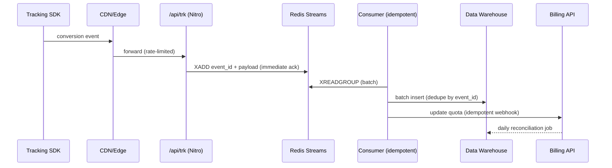

# Execution guide with Claude Code

These files live in `docs/` at the repo root; `CLAUDE.md` at the root wires them to
the agent pipeline in `.claude/agents/` and the skills in `.claude/skills/`.
Claude Code reads `CLAUDE.md` automatically in every session.

## The pipeline in one line

Orchestrator (main session) → implementer agent → `code-reviewer` (qualitative gate)
→ `qa-gate` (deterministic PASS/FAIL per FR) → next phase. Any architectural decision
outside the FRD defaults pauses the work for the human (Architectural Decision
Protocol in `CLAUDE.md`: 3 options with pros/cons). Every agent logs evidence to
`docs/AI_LOG.md`, which `report-writer` compiles into TASK_REPORT.md.

## First command (P0)

In the terminal, at the repo root:

```bash
claude
```

Then send, as the first message:

```text
Read CLAUDE.md, docs/GOALS.md, docs/prd/PRD-00-overview.md and docs/frd/FRD-00-overview.md.
Confirm the 6 agents and 3 skills are loaded (list them), then execute phase P0 (scaffold):
the b2b-fullstack-task-submission structure from the brief — minimal Laravel 11 in backend/,
minimal Nuxt 3 in frontend/, and migrations + factories for campaigns/applicants following
the FRD default decisions. Any decision not already frozen in docs/frd/FRD-00-overview.md
is architectural: STOP and follow the Architectural Decision Protocol in CLAUDE.md
(3 genuinely different options with pros/cons) and wait for my choice before implementing.
Log scaffold choices to docs/AI_LOG.md. Do not start P1 until I approve the scaffold.
```

## Phases with timeboxes (total ≈ 4 h)

1. **P0 — Scaffold (20 min):** folder structure from the brief, minimal Laravel + Nuxt, migrations and factories.
2. **P1 — Backend (70 min):** `backend-laravel` implements FR-B1 to FR-B9, tests included. One prompt per block (endpoint → metrics → tests), not one giant prompt. Close with `code-reviewer` + `qa-gate`.
3. **P2 — Frontend (70 min):** `frontend-nuxt` implements FR-F1 to FR-F9 — contract in `types/` first, then composable, component, test. Close with `code-reviewer` + `qa-gate`.
4. **P3 — Architecture (25 min):** `architecture-analyst` drafts Task 4 into `docs/task4-architecture.md` (FR-R2 to FR-R5). Review it yourself — your edits are senior judgment on display.
5. **P4 — Report (35 min):** `report-writer` compiles `docs/AI_LOG.md` + the Task 4 draft into TASK_REPORT.md (FR-R1 to FR-R5). Final human pass before submitting.

## Kickoff prompt for P1 (after approving the scaffold)

```text
Delegate phase P1 to the backend-laravel agent: implement FR-B1 to FR-B9 from
docs/frd/FRD-backend.md — the applicant-summary endpoint with mock middleware,
FormRequest, ApplicantSummaryService and a JSON:API response per FR-B7, plus the
FR-B9 PHPUnit tests, run until green. The Architectural Decision Protocol applies.
Before refactoring any generated code, save the raw version + prompt to docs/AI_LOG.md.
When done, run code-reviewer and then qa-gate on the result; only close P1 on PASS.
```

## Prompt strategy (what Task 3 wants to see)

- Prompts with an explicit contract (route, status codes, JSON shape) produce less rework than "build the endpoint" — and the brief asks for the literal prompts, so these count as evidence.
- Keep at least one case where you rejected or refactored the output: that is the "raw vs. refactored" material. Natural candidates: aggregation in a PHP loop (turn it into a query), missing division-by-zero guard, button without a `disabled` state, badge conveyed by color only.
- Decision records (`## Decision — ...` in AI_LOG.md) are an ADR trail — cite one in Task 3 as proof of human-in-the-loop judgment.
- In the velocity analysis, cite concrete numbers: time per phase with AI vs. your estimate without it — and describe the implementer → reviewer → gate pipeline as your daily workflow.

## Mermaid diagram baseline (FR-R5, to adapt)


