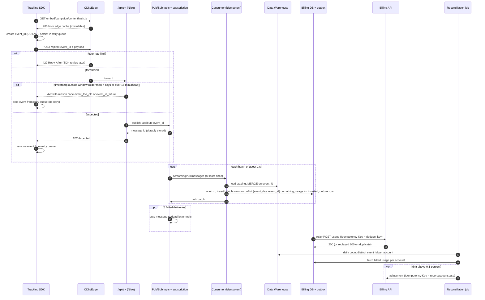

# Task 4: Architecture and Triage (draft)

> Draft by `architecture-analyst` (P3) for `report-writer`. Covers FR-R2 to FR-R5 and PRD-E4.
> **Brief** = stated in the challenge brief / FRD. **Inference** = my reading of the mechanism, to be confirmed against real metrics. **Assumption** = a number we chose, with the math shown.
> The brief gives no traffic volumes. The baseline of **P = 1,000 events/s peak on `/api/trk` today** is ours, not the brief's. Every capacity figure derives from it and from the other assumptions listed in 3.1. Swap in real numbers and the formulas still hold.

---

## 1. Root cause analysis (FR-R2)

### 1.1 Causal chain

```text
viral campaign -> many distinct embed variants -> LRU (MaxKeys 50) thrashes -> every miss recompiles
-> CPU/heap pinned at 100% on Nitro -> event loop stalls -> p95 120 ms -> 4.5 s -> upstream timeouts / OOM restarts -> 502

same saturated Nitro -> /api/trk awaits synchronous warehouse write -> no backpressure, no retry
-> requests time out / are dropped at peak -> warehouse under-counts -> billing diverges
```

### 1.2 Symptom to mechanism

| # | Symptom | Cause | Mechanism | Evidence vs inference |
| --- | --- | --- | --- | --- |
| 1 | CPU/memory at 100% | LRU `MaxKeys: 50` | Working set of embed variants (campaign × config × version, plus any query-string noise in the cache key) is far larger than 50. LRU under a uniform-ish access pattern larger than capacity gives a hit ratio near 0, so every request evicts and the next one recompiles. | Brief: `MaxKeys: 50`, viral script variety, 100% CPU/memory. Inference: key cardinality is inflated by query params. |
| 2 | Recompilation storms | No request coalescing on miss | N concurrent misses for the same key trigger N parallel compiles (thundering herd). Compilation is CPU-bound and blocks the Node event loop. | Inference (the standard Nitro cached-handler behaviour without `swr`/lock). |
| 3 | Periodic spikes even when variety is low | 30 min TTL | Hot entries all expire together under sustained load, so you get a synchronized stampede every 30 min on top of the churn. | Brief: 30 min TTL (Stack Context: `TTL: 30m, MaxKeys: 50`). Inference: synchronized expiry. |
| 4 | p95 120 ms -> 4.5 s | Event-loop saturation | Compile time plus queueing. Once utilisation is near 1, queue wait grows without bound (Little's law), so latency is dominated by waiting rather than work. | Brief: 120 ms -> 4.5 s. Inference: queueing explains the 37x factor. |
| 5 | 502s | Proxy timeouts and pod restarts | LB/proxy upstream timeouts fire on stalled requests. Heap growth from compiled artifacts plus in-flight requests triggers OOM kills, which leave 502s during restart. | Brief: 502s. Inference: split between timeout and OOM (check `OOMKilled` count vs LB 504/502 ratio). |
| 6 | Events lost on `/api/trk` | Synchronous warehouse streaming, no backpressure | Each request holds a connection until the warehouse insert returns. At peak, warehouse latency and quota errors rise while the same CPU-starved process handles them. Requests time out, the SDK fires and forgets, and nothing retries because there is no buffer and no `event_id`. | Brief: synchronous streaming, events dropped at peak. Inference: SDK has no retry. |
| 7 | Billing ≠ events | Two independent counting paths, no reconciliation | Billing counts on a path that does not drop (or drops differently) while the warehouse loses events. With no `event_id` and no reconciliation job, the gap is invisible until a customer disputes an invoice. | Brief: divergence from billing. Inference: billing counts on a separate path. |

### 1.3 Contributing factor (inference)

- The embed render and `/api/trk` share one Nitro deployment. A CPU problem in the embed path becomes data loss in the tracking path. This coupling is the real architectural defect. The LRU size is only the trigger.
- The failure class is **an in-memory buffer exhausted under a viral spike**. Any fix that just moves an in-memory buffer one layer down repeats it. This drives the queue choice in 3.2.

---

## 2. One-hour mitigation (FR-R3): configuration only

Ordered by leverage per minute. The total is about 60 min. Freeze deploys first. **Rule: no code changes in this window.**

| # | Step (time) | Change | Verify | Rollback | Expected impact | Residual risk |
| --- | --- | --- | --- | --- | --- | --- |
| 0 | Incident hygiene (3 min) | Freeze deploys. Snapshot dashboards (CPU, heap, p95, 5xx, `/api/trk` success rate, warehouse insert errors). | Baseline captured | n/a | Something to compare against | none |
| 1 | CDN + `Cache-Control` on embed (10 min) | Nitro `routeRules` header on the embed route: `public, max-age=60, s-maxage=3600, stale-while-revalidate=86400, stale-if-error=86400`. Put the CDN in front of the embed hostname. Cache key = path + variant params only (drop `utm_*` and other tracking params). | CDN hit ratio > 90% within 10 min. Origin RPS on embed drops by roughly the same factor. | Set the CDN behaviour to bypass / remove the header rule | Removes most embed traffic from origin. This is the single biggest lever. | Campaign edits are stale for up to 1 h, so purge on publish. A cache key that is wrong could serve variant A to tenant B, so check the key before you enable it. |
| 2 | Raise LRU `MaxKeys` / TTL (10 min, rolling restart) | `MaxKeys` 50 -> about 2,000 (size = distinct variants seen in the last 24 h of access logs × 1.5). TTL 30 min -> 24 h. Enable `swr` if the cache driver supports it. Raise the pod memory limit and `--max-old-space-size` to fit (assumption: ~200 KB per compiled variant, so 2,000 × 200 KB ≈ 400 MB). | Origin cache hit ratio > 95%. Compile count/min falls to near 0. CPU < 60%. | Revert env/config values, rolling restart | Ends recompilation churn for the requests that still reach origin | Per-pod cache, so new pods start cold (step 1 absorbs this). A larger heap means longer GC pauses. A 24 h TTL relies on purge for correctness. |
| 3 | Horizontal autoscaling of Nitro (5 min, takes effect in about 5 to 10 min) | HPA min replicas ×3. Target CPU 60%. Max replicas sized to the warehouse write quota, not just to CPU. | 502 rate < 0.1%. p95 < 300 ms | Restore the previous HPA spec | Spreads the remaining compile and ingest load | **More pods means more concurrent warehouse writers.** Without step 5 this can increase drops. Cold caches on new pods. |
| 4 | Rate limit `/api/trk` at edge/LB (10 min) | Per-IP and per-tenant token bucket at about 2× normal peak. Return `429` with `Retry-After`. The embed path is exempt because it is served from cache. | 429 share < 1% of requests. Origin RPS flat under spikes. | Switch the rule to log-only | Protects origin from bursts and bots | Users behind carrier NAT can be throttled. Events rejected with 429 are lost unless the SDK honours `Retry-After`, so this is explicit, measurable loss instead of silent loss. |
| 5 | Sample **non-billable** events on `/api/trk` (15 min) | Sampling flag at 10% for non-billable events (pageviews, impressions). **Billable conversions stay at 100%.** Stamp `sample_rate` on every row. | Warehouse insert error rate < 0.5%. Billable accepted vs written gap < 0.1%. | Unset the flag | Cuts warehouse write volume about 5 to 7× (**assumption**: non-billable share of 90 to 95% sampled at 10% leaves 14.5 to 19% of rows, i.e. ~5.3 to 6.9×. Edge case only: approaches 10× if the billable share goes to 0), which frees warehouse quota and Nitro connections for the billable writes | **Trade-off, stated plainly: analytics fidelity degrades during the incident window, billing integrity never does.** Analytics must re-weight by `sample_rate` for that window. Billable writes are still synchronous and unretried, so any that still fail are recovered by the backfill in 3.5. |
| 6 | Verify and hold (7 min) | Watch all dashboards for one full TTL-independent cycle | p95 < 300 ms, 5xx < 0.1%, CPU < 60%, CDN hit > 90% | Roll back steps in reverse order | Stable state | Billing divergence that already happened stays. Backfill it once the reconciliation job (3.2) exists. |

**Do not** raise LB/proxy timeouts to "fix" the 502s. That hides saturation and increases memory held per request.

Rejected for this window (see AI_LOG): an in-process Nitro buffer is a code hotfix under incident pressure, and a disk-buffered log-shipper sidecar cannot be stood up safely inside an hour.

---

## 3. Long-term design for 50x (FR-R4)

### 3.1 Capacity (back-of-envelope)

Every figure is an assumption. None comes from the brief.

| Id | Assumption | Value |
| --- | --- | --- |
| A1 | Peak `/api/trk` today | P = 1,000 events/s |
| A2 | Event size | 0.5 KB |
| A3 | Daily average vs peak | 30% |
| A4 | Billable share of events | 5% |
| A5 | Throughput per subscriber pod (bound by warehouse load) | 5,000 events/s |
| A6 | Publisher batching | 100 messages or 10 ms, whichever first |
| A7 | Subscription retention | 7 days |

| Quantity | Math | Value at 50x |
| --- | --- | --- |
| Peak publish rate | 50 × 1,000 (A1) | **50,000 msg/s** |
| Publish bandwidth | 50,000 × 0.5 KB (A2) | ~25 MB/s. Check against the project's regional publisher throughput quota and request headroom before launch. |
| Publish requests | 50,000 ÷ 100 (A6) | ~500 publish calls/s across all Nitro pods |
| Daily volume | 50,000 × 0.3 (A3) × 86,400 | ~1.3 B msg/day, ~650 GB/day |
| Retained backlog | 650 GB × 7 days (A7) | ~4.5 TB, managed by Pub/Sub. For comparison, Redis Streams would hold 50,000 × 1,800 s × 0.5 KB ≈ 45 GB, i.e. **30 min**, in RAM. |
| Subscribers, steady | 50,000 ÷ 5,000 (A5) | **10 pods** (StreamingPull) |
| Subscribers, max | 2 × steady | 20 pods, autoscaled on `oldest_unacked_message_age` |
| Backlog drain time | 1 h outage at peak = 180 M msgs. Surplus = 20 × 5,000 − 50,000 = 50,000/s. 180 M ÷ 50,000 | ~1 h at peak, faster off-peak |
| Warehouse loads | 10 to 20 subscribers × one micro-batch per ~1 s | 10 to 20 loads/s of ~5,000 rows |
| Billing DB inserts | 50,000 × 5% (A4) | ~2,500 billable rows/s, in 10 to 20 transactions/s |
| Billing dedupe table | 50 × 1,000 (A1) × 5% (A4) = 2,500 billable/s at peak. × 0.3 daily average (A3) × 86,400 ≈ 65 M rows/day. × 8 days (A7 + 1 day margin) | ~65 M rows/day, **~520 M rows**, day-partitioned |
| Dedupe table, upper bound | Same, but every second at peak (ignoring A3): 2,500 × 86,400 × 8 | ≈ 1.7 B rows |
| Sensitivity on A4 | Billable share doubles to 10%: 5,000 billable inserts/s at peak, 5,000 × 0.3 × 86,400 × 8 | ≈ 1 B dedupe rows, billing DB transaction volume doubles. **The billing DB primary feels it first**: unique-index insert throughput and index size on a single writer. Pub/Sub and the warehouse do not change, because total event volume is the same. |
| Embed origin RPS | campaigns × PoPs ÷ 60 s loader TTL | near 0 (hundreds/min at most) |

### 3.2 Components and trade-offs

| Concern | Decision (within FR-R4) | Why / trade-off |
| --- | --- | --- |
| Embed delivery | **Compile at publish time**, not request time. Upload `embed/<campaign>/<contenthash>.js` with `Cache-Control: public, max-age=31536000, immutable`. A tiny `loader.js` (60 s TTL + SWR) points to the current hash. Redis stays only as the origin-side cache for loader/config lookups, decoupled from the billing pipeline. | Removes the LRU and compilation from the hot path entirely. Origin load is independent of traffic. Cost: a publish pipeline, and a 60 s propagation delay for campaign edits. That is acceptable for marketing content. |
| SDK | Generates `event_id` (UUIDv7, time-sortable) at event creation. Keeps a small persistent retry queue (localStorage) and sends with `sendBeacon`/`keepalive` fetch. Honours `429 Retry-After`. Out-of-window rejections (`event_too_old` / `event_in_future`) are dropped from the retry queue, not retried: unlike a 429, retrying can never succeed. | `event_id` at the source is what makes every downstream step idempotent. Retries become safe instead of dangerous. Cost: duplicates are now expected, so every consumer must dedupe. |
| `/api/trk` | Validate schema and size, publish to the `events` topic with `event_id` as a message attribute, return `202` once the publish future resolves. No warehouse call on the request path. No ordering key. **Timestamp window, derived from the dedupe invariant:** reject events whose embedded UUIDv7 timestamp is older than the dedupe retention window minus one day of margin (8 − 1 = 7 days), because an older event maps to an already-dropped partition: dedupe can't remember it, so a replay would double-bill. Also reject timestamps more than **15 minutes** in the future (SDK clock skew), which would write into a not-yet-current partition. Reject, never clamp: clamping forges a new `event_id` and defeats dedupe. Rejections return a 4xx with a machine-readable reason in `errors[].code` (`event_too_old` / `event_in_future`) so SDKs can surface it.<br><br>***The ingestion timestamp window is not input validation — it is the enforcement mechanism of the dedup invariant.*** | Pub/Sub acks a publish only after it is durably stored across zones, so a `202` means the event survives a pod crash. No ordering key means no hot key: a viral campaign (one tenant) spreads across the service like any other traffic. Cost: publish adds tens of ms, so the p99 target is < 100 ms instead of < 50 ms. Events outside the window are lost by design; that is explicit, counted loss instead of a silent double-bill. |
| Queue | **Google Pub/Sub**: one topic, one pull subscription per consumer type, 7-day retention with `retain_acked_messages` so `seek` to a timestamp can replay, dead-letter topic after 5 delivery attempts. | **Why Pub/Sub.** (1) Failure class: the RCA is an in-memory buffer exhausted under a viral spike. Redis Streams at 50x holds about 30 min of backlog in RAM (3.1), so a consumer or warehouse outage longer than that during the next spike drops billing-grade events again. That is the same failure mode one layer up. Pub/Sub retains days and autoscales without capacity planning. (2) Platform signal: the brief names Cloud Pub/Sub and Cloud Tasks as example tech, and the backend already ships Gemini integrations, so we are on GCP and adding no new vendor. (3) Pub/Sub delivers at least once. We do **not** rely on Pub/Sub exactly-once delivery: it is regional, limited to pull subscriptions, and caveated. The idempotent consumer keyed by `event_id`, which FR-R4 already mandates, remains the correctness guarantee. Exactly-once is at best an optimization. **Why not Kafka:** outside FR-R4, and partitions, brokers and rebalancing are more to operate than 50x needs. **Cost we accept:** higher publish latency than Redis, per-GB retention cost, GCP lock-in. |
| Consumer | StreamingPull, flow-controlled to ~5,000 outstanding messages. Per ~1 s batch: (a) load all events to a warehouse staging table and `MERGE` on `event_id` into the fact table. (b) In **one billing DB transaction**: `INSERT ... ON CONFLICT (event_day, event_id) DO NOTHING` into `billable_events`, increment usage by the rows actually inserted, write the outbox row. (c) Ack the batch only after both commit. Autoscale on `oldest_unacked_message_age`. | Redelivery after a crash between commit and ack hits the unique-key conflict, inserts 0 rows and writes no outbox row. Billing is effectively exactly-once and the old under-count window is gone. **Dedupe table:** partitioned by day on `event_day`, derived from the UUIDv7 timestamp inside `event_id`, never from arrival time. Postgres requires a unique constraint on a partitioned table to include the partition key, so the key is `(event_day, event_id)`. Because `event_day` is a pure function of `event_id`, every redelivery lands in the same partition, so this is equivalent to uniqueness on `event_id`. The unique index is the dedupe mechanism. Retention = drop the oldest partition, never `DELETE`. Timestamp window enforced at `/api/trk`; see invariant. Cost: ~520 M-row table (3.1). |
| Billing handoff | **Outbox** table in the billing DB: one row per (account, consumer batch) with `dedupe_key = <account>:<outbox_row_uuid>`, written in the same transaction as the usage increment. A relay posts to Billing API with `Idempotency-Key: <dedupe_key>`. | Decouples billing availability from ingestion. A Billing API outage just grows the outbox. Per-batch aggregation keeps Billing API calls at tens/s instead of 2,500/s. Cost: billing lags ingestion by seconds, so quota enforcement is near-real-time, not exact. |
| Webhooks (both directions) | Outbound: `Idempotency-Key` header, exponential backoff with jitter, receiver stores keys for 7 days and replays the original response. Inbound: unique constraint on the provider's event/delivery ID before any side effect. | At-least-once delivery is the only honest guarantee over HTTP. The dedupe key turns it into effectively-once. Cost: a key table with TTL cleanup. |
| Reconciliation | Daily job per account per UTC day: `COUNT(DISTINCT event_id)` of billable events in the warehouse vs usage in the billing ledger. Drift > 0.1% triggers an alert. Corrections are posted as an adjustment with `Idempotency-Key: recon:<account>:<date>`. | This is the correctness contract. Every other layer may be at-least-once because this one is exact and idempotent, so it is safe to re-run. Cost: one warehouse scan per day, partitioned by date. |

> **Invariant: dedupe retention window ≥ maximum replay window (7-day Pub/Sub retention + 1 day margin = 8 days). If replay can reach further back than dedupe remembers, replay double-bills.**

Enforced at `/api/trk` by the timestamp window (older than 7 days or more than 15 minutes in the future is rejected); see the `/api/trk` row in 3.2.

### 3.3 Signals that matter

| Signal | Alert threshold |
| --- | --- |
| Edge hit ratio (embed) | < 95% |
| `/api/trk` p99 | > 150 ms (target < 100 ms) |
| `/api/trk` publish error rate | > 0.1% |
| Subscription `oldest_unacked_message_age` | > 10 min (days before retention runs out, so this pages for drain, not for loss) |
| Dead-letter topic message count | > 0 sustained for 15 min |
| Outbox age (oldest unsent row) | > 10 min |
| Reconciliation drift | > 0.1% per account/day |

### 3.4 Rollout order

1. SDK `event_id` + retry queue (unlocks everything else, harmless before the pipeline exists).
2. Publish-time compile + immutable assets (retires the incident's trigger).
3. `/api/trk` -> Pub/Sub + consumer, run in shadow alongside the synchronous path for 1 week, then compare counts.
4. `billable_events` dedupe + outbox + idempotent billing webhook.
5. Reconciliation job, plus a one-off backfill for the incident window.

### 3.5 Incident backfill

Divergence from the incident window (and any billable writes that failed under step 5 of section 2) is closed by running the reconciliation job over those dates once it exists. Adjustments carry `recon:<account>:<date>` keys, so re-running is safe.

---

## 4. Proposed flow (FR-R5)



---

## 5. Decisions taken

No open questions remain. Each choice was put to the human under the Architectural Decision Protocol and recorded in `docs/AI_LOG.md`:

- **Queue backbone at 50x:** Google Pub/Sub, overriding the draft's Redis Streams. Entry `Decision — Task 4 queue backbone at 50x — 2026-10-14`.
- **`/api/trk` durability within 1 hour:** sample non-billable events only. Entry `Decision — Task 4 /api/trk durability within 1 hour — 2026-10-14`.
- **Capacity numbers and TTL source:** figures kept as labelled assumptions with the math shown. The 30 min TTL is confirmed in the brief's Stack Context. Entry `Decision — Task 4 capacity numbers and TTL source — 2026-10-14`.
- **`billable_events` dedupe table:** agent-proposed, approved by the human with conditions (day partitioning, the retention ≥ replay invariant, row count derived from A4). Entry `Decision — billable_events dedupe table (agent-proposed, approved with conditions) — 2026-10-15`.
- **Human edit pass: ingestion timestamp window derived from the dedup invariant.** Reject (never clamp) events older than 7 days or more than 15 minutes in the future, and the sampling headline corrected to about 5 to 7×. Entry `Human edit pass — P3 Task 4 draft — 2026-10-15 (human-authored)`.
